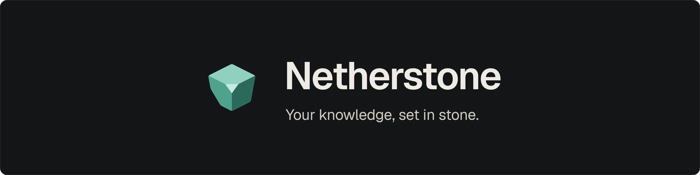

<a href="https://netherstone.app"></a>

[Netherstone](https://netherstone.app) is a free, open-source desktop app for your
knowledge. Every shard is a plain Markdown file in a folder you choose, and it
all works offline.

## Download

Get the latest version for Windows, macOS or Linux from
[Releases](https://github.com/Netherstone-HQ/Netherstone/releases/latest).

On Windows, the installer shows "Windows protected your PC". Click
**More info**, then **Run anyway**. Windows shows this because the installer
isn't code-signed yet. We plan to sign it in a future version.

## Features

- An editor with rich formatting and no syntax in the way
- Instant search, `@` links and `#tags`
- Drawings, images, PDFs, audio and video
- A Gallery of every attachment in your vault
- Charts from tables, and an Overview of your vault
- Every version of a shard or drawing in History
- Import from Word, PDF, HTML and more, and export to PDF, Word or HTML
- Open folders and files from the terminal (`netherstone .`) or your file manager
- Free sync through your own GitHub account
- Light, Dark and three more themes


## Building from source

You need [Node.js](https://nodejs.org/) 22+, [pnpm](https://pnpm.io/) 11,
[Rust](https://www.rust-lang.org/tools/install) and the
[Tauri prerequisites](https://v2.tauri.app/start/prerequisites/) for your OS.

```sh
pnpm install
pnpm tauri dev     # run the app
pnpm test          # run the tests
pnpm tauri build   # build an installer
```

The editor also has browser tests. Build the frontend once, then run them
in a real Chromium (the first run downloads it):

```sh
pnpm exec vite build
pnpm exec playwright install chromium
pnpm test:e2e
```

## Learn more

[Architecture](docs/ARCHITECTURE.md) ·
[Attachments](docs/ATTACHMENTS_ARCHITECTURE.md) ·
[Git sync](docs/GIT_SYNC_ARCHITECTURE.md)

## Community

Questions, ideas and feedback are welcome in
[Discussions](https://github.com/Netherstone-HQ/Netherstone/discussions).
Found a bug? [Open an issue](https://github.com/Netherstone-HQ/Netherstone/issues).

## License

[GNU GPL-3.0](LICENSE)
